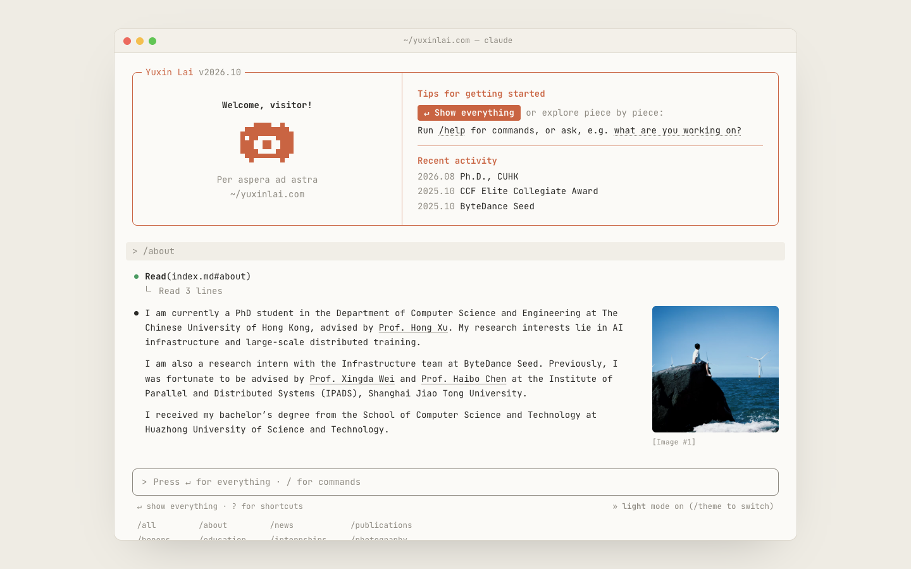

# Yuxin Lai 的个人主页

[yuxinlai.com](https://yuxinlai.com) 的源码。基于 Jekyll，由 GitHub Pages 自动构建发布。页面是一个仿 Claude Code 的可交互终端：访客可以输入斜杠命令或直接提问，也可以点 **Show everything** 一次看完全部内容。



## 修改内容

主页上的所有内容都在 [`index.md`](index.md) 里。改完推送到 `main` 分支，GitHub Pages 会自动重新构建（仓库 Actions 页里的 *pages build and deployment*），一两分钟后生效。

文件头部（两行 `---` 之间）是配置：

| 字段 | 作用 |
| --- | --- |
| `title`、`motto` | 欢迎框里的名字和格言，也用作网页标题和描述 |
| `avatar` | 个人照片，显示在第一节的回答旁边；删掉这一行就不显示 |
| `links` | `/contact` 列出的链接，按书写顺序显示 |
| `gallery` | 摄影网站：`title`、`url` 是名称和地址（`/contact` 末尾也会列出）；`photos` 是 `/photography` 展示的照片（`photo`、`alt`、`caption`，可选的裁切位置 `focus`），都链接到 `url`；`note` 是照片下面的一段 Markdown |
| `milestones` | 欢迎框 Recent activity 里的近况，从早到晚排列，只显示最新三条 |

YAML 里的日期要加引号（`"2025.10"`），否则会被读成数字 2025.1。

正文是普通 Markdown：

- 每个 `## 标题` 是一节，会自动变成一条斜杠命令（`## News` 对应 `/news`），命令菜单里的说明取自这一节的开头。打开页面时会自动执行第一节。
- 以斜体日期开头的列表项，日期会排进左侧的日期栏，例如 `- *2025.08* KunServe is accepted by EuroSys 2026!`。
- 论文写成 `### [标题](链接)`，紧跟的一段（作者、会议）显示为灰色小字。

除了各节，页面还有几条固定命令：`/all`（或在空输入框按回车）展示全部内容，`/help` 列出所有命令，`/theme` 切换深浅色（会记住选择），`/clear` 清空对话。访客直接用英文提问时，会按关键词匹配到对应的节，例如 “any papers?” 显示 Publications；关键词写在 `_layouts/default.html` 的 `hints` 里，新增一节后如果想让提问也能找到它，在那里加一行。

## 本地预览

需要 Ruby 3.3（GitHub Pages 依赖的 commonmarker 还不支持 Ruby 4）：

```sh
brew install ruby@3.3
export PATH="/opt/homebrew/opt/ruby@3.3/bin:$PATH"
bundle install
bash run_server.sh   # 打开 http://127.0.0.1:4000，保存文件后页面自动刷新
```

修改 `_config.yml` 后需要重启服务。

## 文件结构

| 文件 | 内容 |
| --- | --- |
| `index.md` | 主页的全部内容 |
| `_layouts/default.html` | 页面结构和交互脚本：欢迎框、命令、对话记录 |
| `_includes/photo.html` | 带拍摄参数的照片 |
| `assets/css/main.css` | 样式，含浅色和深色两套配色 |
| `_config.yml` | 站点设置：域名、Markdown、插件 |
| `assets/CV.pdf`、`images/` | 简历、个人照片和网站图标 |

## 致谢

最初基于 [AcadHomepage](https://github.com/RayeRen/acad-homepage.github.io)（MIT License）。
