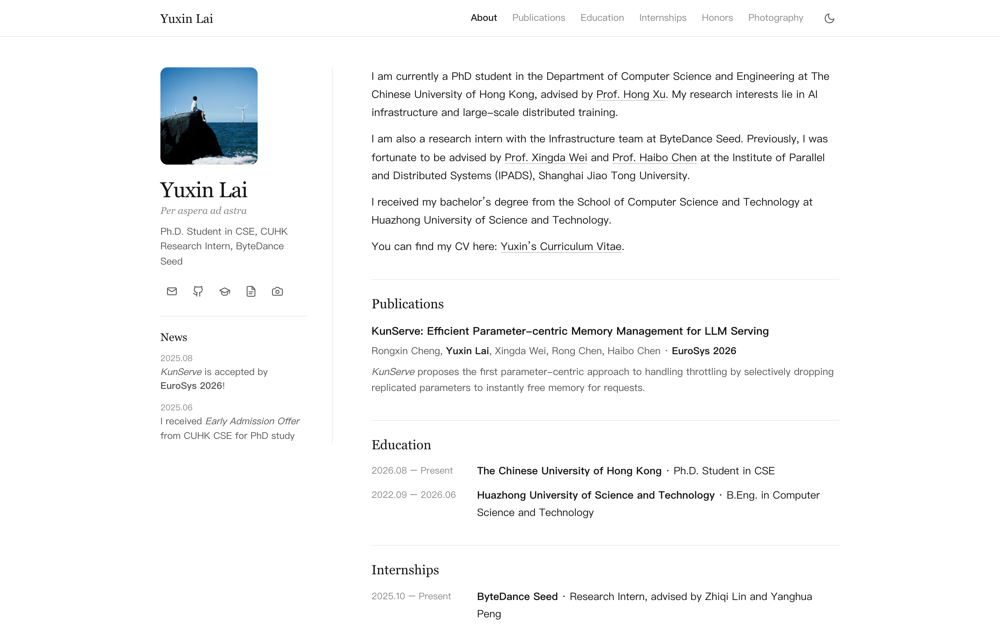

# Yuxin Lai 的个人主页

[yuxinlai.com](https://yuxinlai.com) 的源码。基于 Jekyll，由 GitHub Pages 自动构建发布。页面采用左右分栏布局（支持深浅色跟随系统与手动切换）：顶部吸顶导航栏自动高亮当前章节（移动端可折叠），左栏展示头像、身份、外链图标与近期动态（News），右栏按章节展示个人简介、论文、教育经历、实习、奖项和摄影作品。



## 修改内容

主页上的所有内容都在 [`index.md`](index.md) 里。改完推送到 `main` 分支，GitHub Pages 会自动重新构建（仓库 Actions 页里的 *pages build and deployment*），一两分钟后生效。

文件头部（两行 `---` 之间）是配置：

| 字段 | 作用 |
| --- | --- |
| `title`、`motto` | 左栏的名字和格言，也用作网页标题和描述 |
| `role` | 左栏的身份说明（支持多行） |
| `avatar` | 个人头像；删掉这一行就不显示 |
| `links` | 左栏列出的外链，按书写顺序显示 |
| `gallery` | 摄影作品：`title` 是章节标题，`url` 是摄影站地址（左栏外链末尾也会列出 `Gallery`），`photos` 是展示的照片（`photo`、`alt`，可选裁切位置 `focus`），点击照片会跳转到 `url` |

正文是普通 Markdown：

- `## About` 显示在右栏顶部；`## News` 自动放入左栏下方；其余每个 `## 标题` 按书写顺序在右栏渲染为一节。
- 以斜体日期开头的列表项，日期会自动排进左侧的日期栏，例如 `- *2025.08* *KunServe* is accepted by **EuroSys 2026**!`。
- 论文写成 `### [标题](链接)`，紧跟的一段（作者、会议）和简介会自动套用论文排版样式。

## 本地预览

需要 Ruby 3.3（GitHub Pages 依赖的 commonmarker 还不支持 Ruby 4）：

```sh
brew install ruby@3.3
export PATH="/opt/homebrew/opt/ruby@3.3/bin:$PATH"
bundle install
bash run_server.sh   # 打开 http://127.0.0.1:4000，保存文件后页面自动刷新
```

修改 `_config.yml` 后需要重启服务。

## 文件结构

| 文件 | 内容 |
| --- | --- |
| `index.md` | 主页的全部内容 |
| `_layouts/default.html` | 页面左右分栏模板 |
| `_includes/photo.html` | 摄影作品图片项 |
| `assets/css/main.css` | 样式表 |
| `_config.yml` | 站点设置：域名、Markdown、插件 |
| `assets/CV.pdf`、`images/` | 简历、个人照片和网站图标 |

## 致谢

最初基于 [AcadHomepage](https://github.com/RayeRen/acad-homepage.github.io)（MIT License）。
